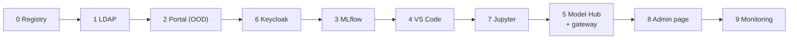

# Admin guide

For the customer's IT admin and our support team. This page shows **what to run and when**. The exact options
and the full troubleshooting tables are in each folder's README under `OOD-Install/`.

## Before you start

- AlmaLinux 9 on every node, root on each.
- Slurm working (`sinfo`, `srun hostname`), and `/home` shared from storage to every node.
- Kubernetes working, with the NVIDIA GPU operator and DRA driver on the GPU nodes, and slurm-bridge installed.
- **Fill in `OOD-Install/site.conf` first.** It is the only file with site values (names, IPs, ports, limits).
  Some values (the LDAP base, user IDs) can't be changed later.

## Install order

Every script is safe to run again, stops at the first error, and ends with a check that says what to expect.

| Step | Folder | Scripts (on master, as root unless noted) |
|---|---|---|
| 0 | [`0-registry`](https://github.com/Ankush610/OOD-Install/tree/main/0-registry) | `setup-registry.sh` |
| 1 | [`1-ldap`](https://github.com/Ankush610/OOD-Install/tree/main/1-ldap) | `1-server.sh`, `2-client.sh` (on **every** node), `add-user.sh <name>` for the first users |
| 2 | [`2-ood`](https://github.com/Ankush610/OOD-Install/tree/main/2-ood) | `setup-ood.sh` |
| 6 | [`6-keycloak`](https://github.com/Ankush610/OOD-Install/tree/main/6-keycloak) | `1-install.sh`, `2-realm.sh`; then set `OOD_AUTH=keycloak` and rerun `2-ood/setup-ood.sh` |
| 3 | [`3-mlflow`](https://github.com/Ankush610/OOD-Install/tree/main/3-mlflow) | `1-build-image.sh` (no root), `2-deploy.sh`, `3-sync-tokens.sh`, `4-install-ood-app.sh` |
| 4 | [`4-vscode`](https://github.com/Ankush610/OOD-Install/tree/main/4-vscode) | `1-install-code-server.sh`, `2-slurm-viewer.sh`, `3-install-ood-app.sh` |
| 7 | [`7-jupyter`](https://github.com/Ankush610/OOD-Install/tree/main/7-jupyter) | `1-install-jupyter.sh`, `2-install-ood-app.sh` |
| 5 | [`5-model-hub`](https://github.com/Ankush610/OOD-Install/tree/main/5-model-hub) | `1-setup.sh`, `2-sync-users.sh`, `4-images.sh` (no root), `7-install-ood-app.sh`, `8-gateway.sh`, then `2-sync-users.sh` again. Tests: `3-test-tenancy.sh`, `5-test-serving.sh`, `6-test-endpoints.sh` |
| 8 | [`8-admin`](https://github.com/Ankush610/OOD-Install/tree/main/8-admin) | `1-install.sh` (root program + sudo rule), `2-install-ood-app.sh` (the page); then Restart Web Server **as the admin** |
| 9 | [`9-monitoring`](https://github.com/Ankush610/OOD-Install/tree/main/9-monitoring) | `1-install.sh` on master (Prometheus + every node; runs the rule tests first), `2-install-ood-app.sh` on the login node (the [Cluster monitor](cluster-monitor.md)); then Restart Web Server **as the admin** |

After installing or changing any portal app: **Restart Web Server** in the portal's top-right menu.

## Next

- [Everyday tasks](daily.md): the Admin page, adding people, limits, logs, backups.
- [Cluster monitor](cluster-monitor.md): nodes, GPUs, services and alerts at a glance.
- [Troubleshooting](troubleshooting.md): what to rerun, and the top problems with their fixes.
