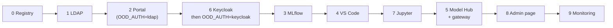

# Admin guide

For the customer's IT admin and our support team. This page lists **what to run, where and in which order**. Each
component's own install page has the details: what it needs, every step, how to check it worked, and a
troubleshooting table.

The scripts are in [OOD-Install](https://github.com/Ankush610/OOD-Install), one numbered folder per component.

## The two machines that matter

| Role | `site.conf` name | What runs there |
|---|---|---|
| **Master** | `MASTER_HOST`, `MASTER_IP` | LDAP, the image registry, Keycloak, MLflow, Kubernetes control plane, Slurm controller, the model gateway, Prometheus, the admin helper |
| **Login node** | `LOGIN_HOST`, `LOGIN_IP` | the portal (Apache + Open OnDemand), users' SSH, the `viewer` partition for editor sessions |
| Compute nodes | `COMPUTE_NODES` | Slurm jobs, Model Hub endpoints (Kubernetes pods), GPU editor sessions |

`LOGIN_HOST` may be master itself (test cluster: one machine called `master` does both). The scripts take the same
path either way. Master reaches the login node as root over SSH. **The login node never gets root on master.**

## Before you start

- [ ] AlmaLinux 9 on every node, and root on each.
- [ ] Internet access on master (packages, PyPI, the Open OnDemand repository). See
      [known issues](../known-issues/install-and-docs.md#other-nodes-also-need-package-access) for other nodes.
- [ ] Slurm working (`sinfo`, `srun hostname`), and `/home` shared from master to every node.
- [ ] Kubernetes with master as a node, and `kubectl` working as root (`/etc/kubernetes/admin.conf`). The NVIDIA GPU
      operator and DRA driver on the GPU nodes.
- [ ] slurm-bridge installed with Helm (namespace `slurm`), and MetalLB with a pool that contains `GATEWAY_IP`.
- [ ] `podman` on master and the login nodes; `containerd` + `crictl` on every Kubernetes node.
- [ ] Apptainer at `APPTAINER` and the training images under `CONTAINERS_ROOT`. OOD-Install doesn't install these;
      see [OOD-Container](https://github.com/Ankush610/OOD-Container).
- [ ] `MASTER_HOST` resolves to `MASTER_IP` on every node (`/etc/hosts`). `hostname -s` on master and the login
      node equals `MASTER_HOST` and `LOGIN_HOST`.
- [ ] Passwordless root SSH from master to the login node and every compute node.
- [ ] The OOD-Install folder sits on the shared `/home`, so every node sees the same copy.
- [ ] If the login node is a separate machine: `/home` mounted, munge + `slurmd` installed, the `kubectl` binary,
      and the ports in [Ports and firewall](../reference/ports-and-firewall.md#ports-you-must-open-yourself) open.
- [ ] **Fill in `site.conf`.** It is the only file with site values. See the [`site.conf` reference](../reference/site-conf.md).
      The LDAP base DN and user IDs can't be changed later.

## Install order

Every script is safe to rerun, stops at the first error, prints numbered `== N.` steps, and ends with a check that
says what to expect. Each one prints `Run with sudo.` or `Run this on <host>.` if you start it the wrong way
(a few scripts don't check the host yet; see [known issues](../known-issues/install-and-docs.md#not-every-script-checks-its-host)).

!!! warning "First install: start with `OOD_AUTH=ldap`"
    `site.conf` ships with `OOD_AUTH=keycloak`. With that value, `2-ood/setup-ood.sh` stops until Keycloak is
    installed, but Keycloak's installer needs the portal's certificate, which `2-ood` makes. On a new cluster, set
    `OOD_AUTH=ldap` for step 2, and switch to `keycloak` after step 6.



| Step | Component | Scripts | Runs on |
|---|---|---|---|
| 0 | [Registry](install/registry.md) | `setup-registry.sh` | master |
| 1 | [LDAP](install/ldap.md) | `1-server.sh`; `2-client.sh` on **every** node; `add-user.sh <name>` for the first people | master (+ every node) |
| 2 | [Portal (OOD)](install/portal.md) | `setup-ood.sh` | login node |
| 6 | [Keycloak](install/keycloak.md) | `1-install.sh`, `2-realm.sh`; then `OOD_AUTH=keycloak` and rerun `2-ood/setup-ood.sh` | master (+ login node) |
| 3 | [MLflow](install/mlflow.md) | `1-build-image.sh` (no root), `2-deploy.sh`, `3-sync-tokens.sh`; `4-install-ood-app.sh` | master; app on login node |
| 4 | [VS Code](install/vscode.md) | `1-install-code-server.sh`, `2-slurm-viewer.sh`; `3-install-ood-app.sh` | master; app on login node |
| 7 | [Jupyter](install/jupyter.md) | `1-install-jupyter.sh`; `2-install-ood-app.sh` | master; app on login node |
| 5 | [Model Hub](install/model-hub.md) | `1-setup.sh`, `2-sync-users.sh`, `4-images.sh` (no root), `8-gateway.sh`, `2-sync-users.sh` again; `7-install-ood-app.sh` | master; app on login node |
| 8 | [Admin page](install/admin-page.md) | `1-install.sh`; `2-install-ood-app.sh` | master; app on login node |
| 9 | [Monitoring](install/monitoring.md) | `1-install.sh`; `2-install-ood-app.sh` | master; app on login node |

The rule for where a script runs: anything under `/var/www/ood` or in Apache's config runs on the **login node**;
everything else runs on **master**. The full list is in [Scripts](../reference/scripts.md).

After installing or changing any portal app or setting: click **Restart Web Server** in the portal's top-right
menu. The portal caches its settings per user.

!!! tip "People added early"
    `add-user.sh` also creates the person's MLflow token, Model Hub space and Keycloak one-time password, but skips
    each part that isn't installed yet. If you add people before steps 3, 5 or 6, run `3-mlflow/3-sync-tokens.sh`
    and `5-model-hub/2-sync-users.sh` once those steps are done.

## Open the portal

- **Production:** users open `https://<portal>` (`OOD_SERVERNAME`). No SSH needed. Everything is reached through the
  portal, plus the gateway address for calling models.
- **Test cluster behind a jump host:** forward local port **443** (the portal redirects every other port):

    ```bash
    sudo ssh -J <you>@<jump-host> -L 443:localhost:443 <you>@<login-node>
    ```

    Then open `https://localhost`.

## Next

- [Everyday tasks](daily.md): the Admin page, adding people, limits, logs, backups.
- [Cluster monitor](cluster-monitor.md): nodes, GPUs, services and alerts at a glance.
- [Troubleshooting](troubleshooting.md): what to rerun, and the top problems with their fixes.
- [Known issues](../known-issues/index.md): bugs and gaps found in the install scripts.
