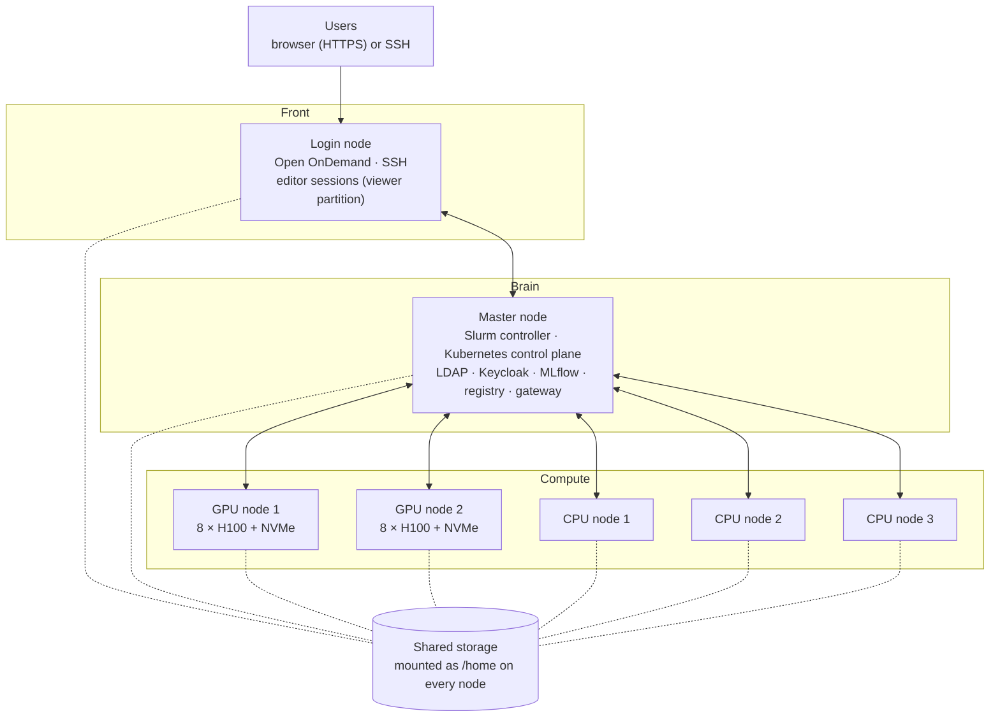

# Cluster architecture

## What it is

The machines AI-Factory runs on, and what runs on each one. Everything else in these pages sits on top of this.

## The assumed cluster (one Rudra rack)

| Machine | How many | What it is for |
|---|---|---|
| **Master node** | 1 | the "brain": job queue (Slurm), Kubernetes control, user list (LDAP), web login (Keycloak), MLflow, image registry, model gateway. No user logins |
| **Login node** | 1 | where users come in: the web portal (OOD), SSH, light editor sessions |
| **GPU nodes** | 2 | 4–8 GPUs each (target: 8 × H100), connected by NVLink, with fast local NVMe disks. Training and model serving |
| **CPU nodes** | 3 | many cores, lots of RAM, no GPU. Data prep and classic ML |
| **Shared storage** | 1 | mounted as `/home` on **every** node. Same files everywhere |

(test cluster: one machine called `master` does the master **and** login jobs: `LOGIN_HOST` = `MASTER_HOST` in
`site.conf`. The install scripts take the same steps either way, so moving the login jobs to their own machine is a
`site.conf` change plus a rerun. There are two compute nodes,
`cn01` and `cn02`, each with 48 cores and 1 × NVIDIA A30 GPU.)



## What runs where

| Software | Master | Login | GPU / CPU nodes |
|---|---|---|---|
| Slurm (job queue) | controller (`slurmctld`, `slurmdbd`, `slurmrestd`) | user commands; runs editor sessions | runs jobs (`slurmd`) |
| Kubernetes | control plane | — (users get `kubectl` access only) | runs pods (`kubelet`, `containerd`) |
| LDAP (user list) | the server | client (SSSD) | client (SSSD) |
| Keycloak (web login) | yes (next to LDAP; only the login node may reach it) | — (OOD's Apache passes `/auth` on to it) | — |
| Open OnDemand (web portal) | — | yes | — |
| MLflow | yes (one Kubernetes pod) | — | — |
| Container registry | yes | — | pulls images from it |
| Gateway (model API door) | yes (one Kubernetes pod) | — | — |
| Apptainer (runs training images) | — | yes (for tests) | yes (jobs run here) |
| GPU drivers + NVIDIA DRA driver | — | — | GPU nodes only |

## Shared vs local

Some things are **one copy for the whole cluster**. Others are **separate on each node**.

```
 SHARED (one copy, the same on every node)      LOCAL (each node has its own)
 ─────────────────────────────────────────      ─────────────────────────────
 /home/<user>      people's files               the operating system
 /home/apps        shared software, images,     drivers (GPU, network)
                   models, service data         /tmp scratch disk, NVMe cache
 users and groups  (from LDAP)                  services: slurmd, kubelet, sssd
```

**Why this matters:** a user's files, the software and the user IDs are the same on every node. So a job can
run on any node, as that user, and see exactly the same files.

## What lives in /home

```
/home
├── <user>/                 private to that user (mode 700: nobody else can even look inside)
│   ├── models/             their own model files (for example, fine-tuned LLMs)
│   ├── data/               their datasets
│   └── .mlflow/credentials their MLflow job token
└── apps/                   shared, read-only for users, written by admins
    ├── containers/         training and serving images (Apptainer)
    ├── models/             base models from the admin, and public model copies
    ├── code-server/        VS Code install
    ├── jupyter/            JupyterLab install
    ├── mlflow-shared/      MLflow's database and files (only MLflow can read it)
    ├── registry/           storage behind the image registry
    └── keycloak/           Keycloak's database (only Keycloak can read it)
```

## Who talks to whom (network)

| Port | Service | On |
|---|---|---|
| 443 | web portal (OOD) and Keycloak login (passed on to master) | login node |
| 8180 | Keycloak (only from the login node) | master |
| 443 | model gateway (its own IP address) | master |
| 22 | SSH (the login node → master: only the admin page's restricted key) | all |
| 389 / 636 | LDAP | master |
| 2049 | NFS (shared /home) | storage |
| 6817–6819 | Slurm | master and nodes |
| 6443 | Kubernetes API | master |
| 5000 | image registry (inside the cluster only) | master |
| 30500 | MLflow (jobs use it inside the cluster) | master |
| 9090 | Prometheus (only from the login node) | master |
| 9100 | node_exporter (only from master) | all |

The full list, with the firewall rules the scripts add: [Ports and firewall](../reference/ports-and-firewall.md).

Users from outside the rack need only **two addresses**: the portal (443) and the gateway (443).

## Limits and notes

- **Single master and single gateway.** If the master stops, logins and new jobs stop until it is back. Running
  jobs keep running. We agreed that up to an hour of downtime is OK for a research tool.
- **GPU node naming rule:** Slurm and Kubernetes must not use the same name for the master/login machine (see
  [05](05-slurm-and-kubernetes.md#a-naming-trap)).
- **Open question for seniors:** the NVMe size on the GPU nodes, and whether there is anything faster than NFS for
  shared files.
