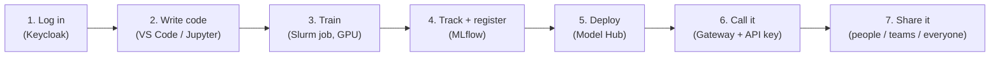
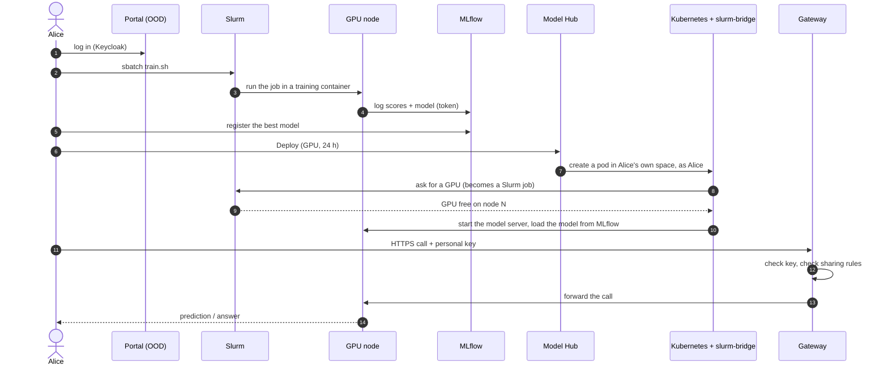

# End-to-end flow: from login to a model others can call

This page follows one user, **Alice**, through the whole platform. Each step links to the page that explains
that part in detail.

## The journey in one picture

## Step by step

### 1. Log in — [03](03-users-and-login.md), [04](04-web-portal-ood.md)
- Alice opens the portal address in her browser.
- The Keycloak login page appears. She types her cluster username and password.
- She lands on the AI-Factory dashboard. The same login now works for MLflow and Model Hub, with no second password.

### 2. Write code — [07](07-vscode-and-jupyter.md)
- **Interactive Apps → VS Code** (or **Jupyter**). She picks "Editor only" or "GPU node", and clicks **Launch**.
- A few seconds later she clicks **Connect**. The editor opens in her browser, running as **her**, with her files.
- In Jupyter, every training container shows up as a ready kernel (PyTorch, TensorFlow, classic ML…).

### 3. Train — [05](05-slurm-and-kubernetes.md), [06](06-containers-and-registry.md)
- She submits a training job (`sbatch job.sh`) from the editor's terminal.
- Slurm waits for a free GPU, then runs her script inside a ready-made container (for example, the PyTorch image).
- Long training runs in the queue as a normal job, so it does not hold an editor session open.

### 4. Track and register — [08](08-mlflow.md)
- Her script logs settings, scores and the model to **MLflow**. Login is automatic, from a token in her home.
- In the MLflow web page she compares runs, picks the best one and clicks **Register model**.
- Only Alice can see her runs and models, unless she makes a model public.

### 5. Deploy — [09](09-model-hub.md)
- **Interactive Apps → Model Hub** lists her registered models.
- She opens one, picks CPU or GPU and how many hours, and clicks **Deploy**.
- Model Hub starts the model as a service. If all GPUs are busy, it **waits in line** and shows its place in the
  queue. It never stops someone's training job.

### 6. Call it — [10](10-gateway-and-api-keys.md)
- On the **API key** page she makes her personal key (shown once).
- The endpoint's **API** tab shows a ready-to-copy `curl` and Python example with the gateway address.
- She can call the model from a notebook on the cluster or from her laptop.

### 7. Share it — [10](10-gateway-and-api-keys.md#sharing)
- **Share** on the endpoint: only me, chosen people, teams, or everyone.
- Bob (whom she shared with) sees it under **Shared with me**. He calls it with **his own** key.
- She can also make the **model files** public, so others can deploy or download their own copy.

## What happens behind the scenes

## Three kinds of models, same path

| | Classic ML | Deep learning | LLM (large language model) |
|---|---|---|---|
| Examples | scikit-learn, XGBoost, LightGBM | PyTorch image or tabular nets | Qwen, Llama, Mistral (Hugging Face format) |
| Trains on | CPU node | GPU node | GPU node |
| Saved into MLflow by | `mlflow.sklearn.log_model` (or similar) | `mlflow.pytorch.log_model` | files stay in `~/models`; `model-register` adds an MLflow entry pointing to them |
| Served by | MLflow model server (CPU) | MLflow model server (GPU or CPU) | vLLM (GPU) |
| Called with | `/invocations` | `/invocations` | OpenAI-style `/v1/chat/completions` |
| Model Hub "Playground" | form built from the model's inputs | form or JSON | chat window |

**Why LLMs are different:** an LLM is many gigabytes. Copying it into MLflow would double the disk use. So the
files stay where they are, and MLflow only keeps a record that points to them. Model Hub still lists it like any
other model.

## The rules the platform keeps for you

- Everything runs **as the user**, with the user's own file permissions.
- One GPU per person for model serving by default. The admin can raise one person to two.
- A deployed model runs **1 day** by default, **4 days** at most. After that, the GPU goes back to training.
- Training always comes first. Models wait for free GPUs. No GPUs are kept aside only for serving.
