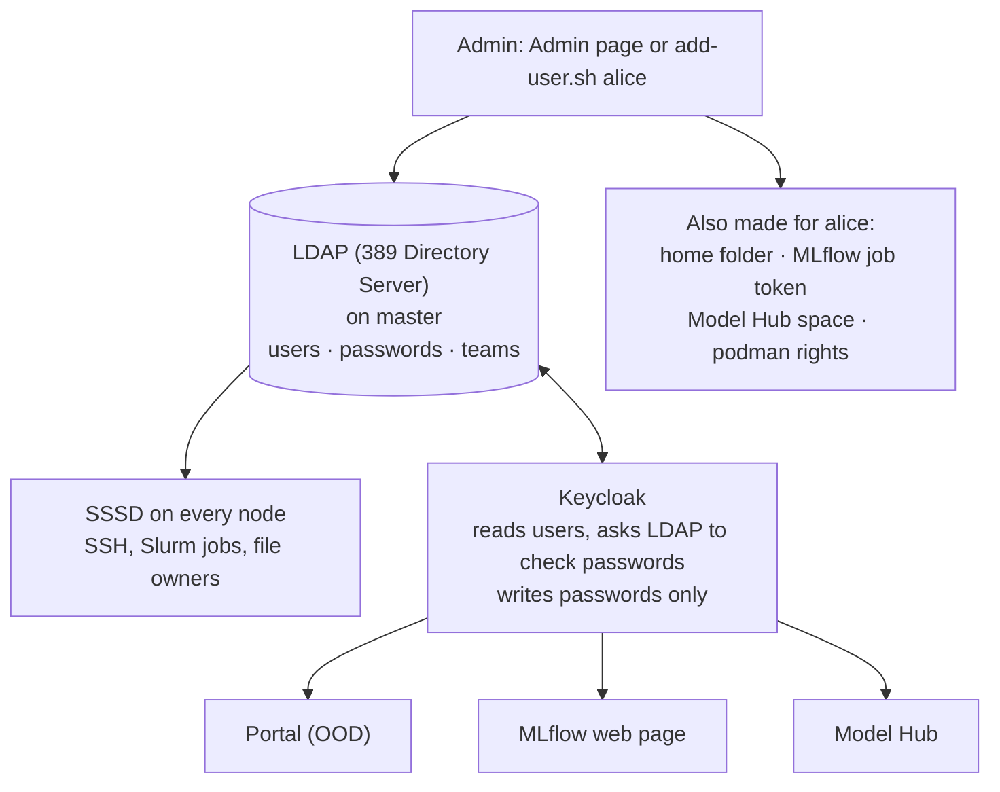
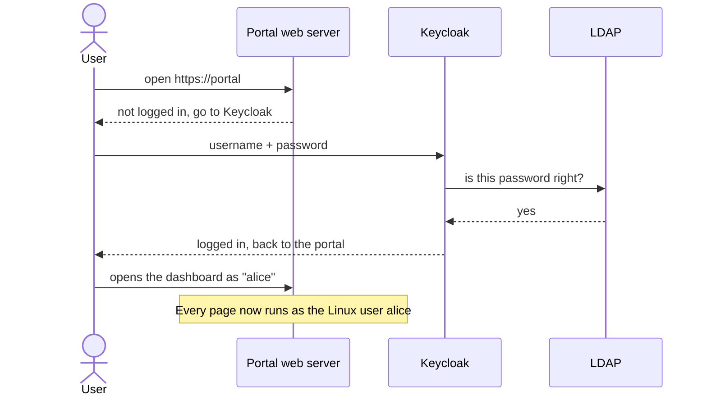

# Users and login (LDAP + Keycloak)

## What it is

- **LDAP** is the cluster's **one list of users**: names, user IDs, passwords and teams.
- **Keycloak** is the **one login page** for every web tool. You log in once, and the portal, MLflow and Model Hub
  all know who you are.

## Why we need it

- Without one user list, every node would have its own users, with different IDs, so files and jobs would break.
- Without one login, users would type their password again for every tool.
- The customer's admin adds a person **once**, and that person can use everything.

## How it fits together

## How it works

**LDAP (the user list)**
- Runs on the master node (389 Directory Server).
- Every node runs **SSSD**, which asks LDAP "who is user 1005?". So Alice has the **same user ID on every node**.
- Passwords are stored only as a one-way hash. Nobody, not even the admin, can read a password.
- Anyone can read the user list (nodes need it), but not passwords. Each user can change only their own password.
- **User IDs are never reused.** The highest ID ever handed out is stored (`/root/.ldap-last-uid`). So if a removed
  person's home folder is kept, the next new person can never end up owning it.

**Keycloak (the login page)**
- Runs on the login node, next to the portal. It is reached only through the portal's own HTTPS address
  (`https://<portal>/auth`), never directly.
- It **reads** users from LDAP and **asks LDAP** to check each password. LDAP stays the only user list.
  Nothing is copied or kept in two places.
- It may **write one thing** to LDAP: a password, when a user chooses a new one in the browser. For this it has its
  own LDAP account that may change passwords and nothing else, and it talks to LDAP encrypted (ldaps, port 636).
- It uses the standard OpenID Connect protocol. The portal, MLflow and Model Hub trust its answer.
- It runs as two containers (Keycloak + its Postgres database) under systemd, **not** in Kubernetes. So login
  still works if Kubernetes has a problem.
- Web sessions last 8 hours, then Keycloak asks again.
- **Signing out ends every tab.** When a Keycloak session ends (sign-out, "sign out other devices", or the admin
  removes the person), Keycloak tells the portal at once ("back-channel logout"). Open portal tabs go to the login
  page on their next click; Model Hub pages within 5 seconds.

**The login flow**

**New people: one-time passwords**
- The admin types a first password for the new person (or clicks **Generate**) and gives it to them.
- It works once: at their first browser login, Keycloak asks them to choose their own password.
- The new password is written to LDAP, so it works everywhere: SSH, Slurm, portal, MLflow, Model Hub.
- The same happens when the admin resets someone's password.

**Removing a person** (`1-ldap/remove-user.sh`, or the Admin page)
- Always: stops all their jobs, sessions, processes and model endpoints; deletes their API key and Kubernetes space;
  takes them out of every team and every share; signs them out everywhere; then deletes them from Keycloak and LDAP
  (LDAP last, so a failed run can simply be run again).
- Models that only they managed become private, so public copies go away.
- Two options, both **off** by default: delete their home folder; delete their MLflow runs and models.

**Teams**
- An admin can make **teams** in LDAP (for example `nlp`) and add people to them.
- Teams are only used for **sharing models** in Model Hub. They give no file rights.

**Two kinds of accounts**

| Kind | User IDs | In LDAP? | Examples |
|---|---|---|---|
| People | 1000 and up | yes | alice, bob |
| Service accounts | below 1000 | no, local on master | `mlflow` (950), `modelhub` (951), `keycloak` (949) |

Service accounts sit below 1000, so they can never clash with a real person.

**Logins that are not passwords**
- **Training jobs** can't type a password. Each user gets a random **MLflow token** in `~/.mlflow/credentials`. It
  keeps working when the password changes.
- **Model API calls** use a **personal API key** from Model Hub (see [10](10-gateway-and-api-keys.md)).

## What the user sees

- One login page with the AI-Factory name and background.
- The first time they log in (or after the admin reset their password): a page asking them to choose a new password.
- The same username and password for the portal, SSH, MLflow and Model Hub.
- They change their password with `passwd` over SSH.

## What the admin does

- **From the browser:** the **Admin** page in the portal: add a person (with a one-time password), remove one,
  reset a password, teams, limits. See the [Admin guide](../admin/daily.md).
- **From the terminal:** `1-ldap/add-user.sh` makes the LDAP entry, the home folder, the MLflow job token, the Model
  Hub space, and the rights to build images. `1-ldap/remove-user.sh` removes a person. Everything else (passwords,
  teams, checks) is in one text menu: `1-ldap/menu.sh`. The Admin page calls these same scripts.
- **Keycloak's admin console:** `https://<portal>/auth/admin`.
- **Way back in:** one local admin account (`admin`) is kept **outside** LDAP on purpose. If LDAP breaks, the
  admin can still log in.

## Limits and known issues

- **Local account with the same name wins.** If a node has a local user with the same name as an LDAP user, the
  local one is used on that node. That can give the wrong home folder. The menu's **Check** finds these.
- After a password change, MLflow may take up to 5 minutes to accept the new one (it caches logins). For the same
  reason, a removed person's open MLflow page can keep working up to 5 minutes (with no rights left).
- A user who only uses SSH (never the browser) keeps the one-time password until they run `passwd`.
- Rudra brings **its own** LDAP. Connecting to a customer's Active Directory is not part of this version.

Details: [OOD-Install/1-ldap/README.md](https://github.com/Ankush610/OOD-Install/blob/main/1-ldap/README.md), [OOD-Install/6-keycloak/README.md](https://github.com/Ankush610/OOD-Install/blob/main/6-keycloak/README.md).
