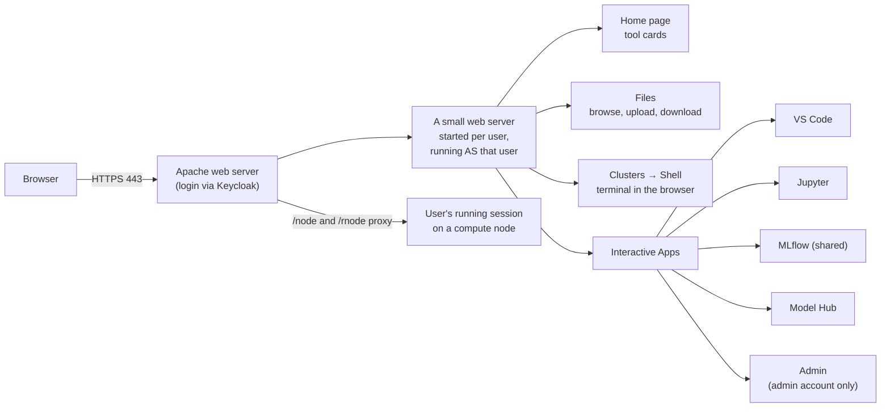

# Web portal (Open OnDemand)

## What it is

**Open OnDemand (OOD)** is the web portal, the front door of AI-Factory. It is an open-source portal made for
HPC clusters. We brand it as **AI-Factory**, and add our own apps to it.

## Why we need it

- Users get everything from a browser. They do not need SSH, a VPN client or Linux skills.
- It already knows how to start things **as the logged-in user** on a Slurm cluster. That is the hardest part
  to do safely, and we don't have to build it ourselves.
- One address for everything. The only other address users need is the model gateway.

## How it works

- **Apache** takes every request on port 443 and checks the login (through Keycloak).
- After login, OOD starts a **small web server for each user, running as that Linux user**. Every page that
  user opens runs with their rights. So when Model Hub calls `kubectl`, or VS Code calls `sbatch`, it is
  really Alice doing it, not a shared service account.
- **The proxy:** a VS Code or Jupyter session runs on some compute node, on some port. OOD passes the browser
  through to it (`/node/<host>/<port>/…`), so users never need to open ports or tunnels.
- **Cluster file:** OOD knows our Slurm cluster, so its apps can submit jobs.

## What the user sees

- The AI-Factory login page (Keycloak), then the **home page**: our tools as cards, in sections, one below the other.

  | Section | Cards |
  |---|---|
  | **Develop** | Jupyter, VS Code, Shell |
  | **Track & Deploy** | MLflow, Model Hub |
  | **Data & Cluster** | Files |
  | **Admin** | AI Stack Admin (admin account only) |

  Each card has the tool's icon, a one-line note on what it does, and **Open**, which goes to the same page as the
  top bar. A card shows only if the user may open that app. Tools hidden from the top bar are not on the home page either.
- A navy top bar with the C-DAC logo and three menus only:
  - **Files** — their home folder.
  - **Clusters** — a shell in the browser, and system status.
  - **Interactive Apps** — Model Hub, VS Code, MLflow (shared), Jupyter; and **Admin** for the admin account.
- Our own app pages (VS Code, Jupyter, MLflow, Model Hub) have the same top bar, so the whole thing feels like one product.
- Footer: "© 2026 C-DAC India — Government of India".

We hid OOD's extra menus (Jobs, My Interactive Sessions, Desktop) to keep it simple. They still exist if you
type their address.

## What the admin does

- Install: `2-ood/setup-ood.sh`. It sets up HTTPS, the login, the proxy, the Slurm cluster file, and the AI-Factory look.
- **Login mode** is one setting in `site.conf`: `OOD_AUTH=keycloak` (one login for everything) or `ldap` (the
  browser asks for a password; this is the fallback). Rerun the script after changing it.
- **Home page cards:** the tool list and texts are at the top of `2-ood/branding/_ai_tools.html.erb`. Rerun
  `setup-ood.sh` after changing them.
- **After any change to OOD settings or apps:** click **Restart Web Server** in the top-right menu. OOD caches its
  settings per user, so changes show only after this.

## Limits and known issues

- The certificate is self-signed by default. The customer can give us a real one.
- Our app pages (VS Code, Jupyter) do not show in OOD's own "My Interactive Sessions" list. Their own page lists them.
- The admin account is not in LDAP, so it gets no MLflow / Model Hub cards (both log in through LDAP). The two
  still show in its Interactive Apps menu (that menu is the same for everyone).
- In `ldap` login mode, a browser keeps one login per site until it is fully closed. Keycloak mode fixes this.

Details: [OOD-Install/2-ood/README.md](https://github.com/Ankush610/OOD-Install/blob/main/2-ood/README.md).
