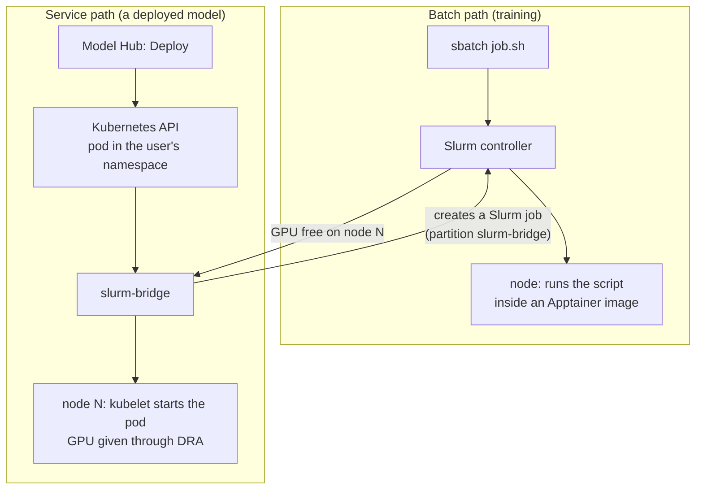

# Slurm and Kubernetes (the engine)

## What it is

The engine that runs all the work. It has three parts:

| Part | What it does | Simple picture |
|---|---|---|
| **Slurm** | the job queue. It owns the nodes and the GPUs, and decides who runs next | the booking desk |
| **Kubernetes** | runs long-running **services** (MLflow, the gateway, deployed models) and restarts them if they crash | the building manager |
| **slurm-bridge** (from the Slinky project) | turns a Kubernetes pod into a Slurm job, so services book GPUs at the **same desk** as training | the phone line between the two |

## Why we need both

- **Slurm** is the standard for training on HPC clusters: fair queues, time limits, GPU booking.
- **Kubernetes** is the standard for running services: networking, restarts, health checks.
- Both want to use the same GPUs. Without the bridge, Kubernetes would grab GPUs that Slurm thinks are free, and
  jobs would crash. **slurm-bridge** makes Slurm the only one who hands out GPUs. So one queue covers training
  **and** model serving.

## How it works

**The batch path (plain Slurm, no Kubernetes)**
- The user submits a script. Slurm waits until the asked CPUs/GPUs are free, then runs it on a node.
- The script runs **as the user**, usually inside an Apptainer container (see [06](06-containers-and-registry.md)).
- Slurm cuts the job off at its time limit and frees the GPU.

**The service path (Kubernetes through slurm-bridge)**
- Model Hub creates a pod in the user's own Kubernetes **namespace** (a private space, `u-<user>`).
- Because that namespace is marked "managed by slurm-bridge", the bridge turns the pod into a **Slurm job** in the
  `slurm-bridge` partition. The pod carries Slurm settings: time limit, job name, "don't take the whole node".
- When Slurm says "run on node N", the pod starts there. The GPU is handed to the pod through Kubernetes'
  **DRA** (Dynamic Resource Allocation) and the NVIDIA DRA driver.
- When the time is up, Slurm ends the job and the pod stops. The GPU goes back to the queue.

**Partitions (groups of nodes in Slurm)**

| Partition | Used for |
|---|---|
| CPU / GPU partitions | normal training jobs (names are set per site) |
| `slurm-bridge` | Kubernetes pods that became Slurm jobs (deployed models) |
| `viewer` | light editor sessions (VS Code / Jupyter "Editor only") on the login node |

**The `viewer` partition (sharing the login node safely)**
- The login node runs editor sessions **and** SSH, the portal and other services.
- Slurm keeps a fixed share of cores and memory **out** of its own hands (test cluster: 8 cores and 48 GB). So SSH
  and the services always have room, however many editors are open.
- The rest is shared: up to 4 editor sessions per core (an open editor uses almost no CPU). Memory is the real
  limit (2 GB per VS Code session, 4 GB per notebook).

## What the user sees

- Training: `sbatch`, `squeue`, `scancel`, like any HPC cluster.
- Model serving: they never touch Slurm or Kubernetes. Model Hub shows "waiting for a free GPU (number N in the
  queue)", then "running".

## What the admin does

- **One-time Model Hub setup** (`5-model-hub/1-setup.sh`): creates the GPU classes from what Slurm reports, and
  switches on the GPU part of slurm-bridge's scheduler.
- **After every upgrade of slurm-bridge:** run `5-model-hub/1-setup.sh` again (see below).
- Per user: `5-model-hub/2-sync-users.sh` creates their namespace, GPU limit and time limit.

## A naming trap

slurm-bridge puts a "keep out" mark (a taint) on every Kubernetes node whose **name** matches a Slurm node. If the
master/login machine had the same name in both, every system service on it (cluster DNS, certificates, GPU
operator…) would be thrown off. So the login machine's Slurm name is different (`viewer01`), while it is the
same computer. **Never give a Slurm node the same name as a Kubernetes node that runs system services.**

## Limits and known issues

- **slurm-bridge is young** (version 1.2.x). We found two GPU problems on the way. We pin its version and test GPUs
  after every install.
- **An upgrade of slurm-bridge resets its scheduler settings.** Pods still get a Slurm job, but **no GPU inside**.
  Fix: rerun `1-setup.sh`. This caused the GPU outage on 2026-09-30.
- Deployed models must be **single pods**, not Kubernetes "Deployments". slurm-bridge reads the Slurm settings only
  from the top object. Under a Deployment the time limit was ignored (365 days), and an ended model would restart
  forever.
- 2-GPU models (tensor parallel on one node) are built but can only be tested on the H100 nodes.
- **Network lock not done yet.** Today any pod can reach any other pod. It is the first step on the roadmap.
