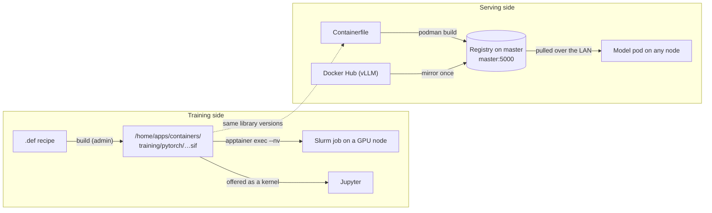

# Containers and the image registry

## What it is

A **container image** is a ready-made box of software: Python, PyTorch, CUDA and all their libraries, at fixed
versions. Users run their code inside it, so they don't have to install anything.

AI-Factory uses **two kinds**, for two jobs:

| | Apptainer image (`.sif` file) | OCI image (Docker-style) |
|---|---|---|
| Used for | **training** and other batch jobs | **serving** models (Model Hub) |
| Run by | Slurm, with `apptainer exec` | Kubernetes, as a pod |
| Stored in | `/home/apps/containers/` (a file on shared storage) | the cluster's image registry on master |
| Runs as | the user, no root, no daemon | the user's ID (forced by a cluster rule) |

## Why we need it

- Everyone trains with the **same, tested** software. "It works on my machine" problems go away.
- Compute nodes have no internet. Images must already be inside the cluster.
- Kubernetes can't use Apptainer files, and Apptainer is the HPC standard for jobs. So we keep both, each for its own job.

## How it works

**Training images (Apptainer)**
- One folder per family, versions side by side: `training/pytorch/pytorch-2.10.0-cuda12.9.sif`.
- Next to each image: its recipe (`.def`) and notes on why each version was chosen.
- **Rules for every training image:** it has `ipykernel` (so Jupyter can offer it) and the MLflow client (so every
  job can record its runs).
- A tool, `apptainer.sh`, is the one place that knows where Apptainer is installed.

| Family | Status |
|---|---|
| PyTorch (base, LLM) | built and tested |
| Classic ML (scikit-learn, XGBoost, LightGBM), CPU | built and tested |
| PyTorch NLP / vision, TensorFlow | recipes ready, to rebuild with MLflow |
| RAPIDS, TensorFlow NLP / vision | recipes only |
| Serving by hand: vLLM, SGLang, llama.cpp | built and tested (Slurm, not Model Hub) |

**Serving images (registry)**

| Image | Serves |
|---|---|
| `mlflow-serve-ml` | classic ML models (CPU) |
| `mlflow-serve-torch` | PyTorch models (GPU or CPU) |
| `vllm-openai` | LLMs (GPU), a pinned copy of the official vLLM image |

**The version-match rule**
- A classic ML or PyTorch model is saved as a "pickle". It loads correctly only with the **same library versions**
  it was trained with.
- So each serving image is built using the exact package list of its training image. Train in
  `ml-classic-cpu.sif` → serve with `mlflow-serve-ml`. Train in the PyTorch image → serve with `mlflow-serve-torch`.
- LLMs are plain weight files (safetensors), so this rule doesn't apply to them.

**The registry**
- A small image registry runs on master (`master:5000`). Every Kubernetes node is set up to pull from it.
- It is the bridge between podman (where images are built) and Kubernetes (which can't see podman's images).
- Users can push their own images too: `k8s-image build myapp:v1 .` builds and pushes in one step.

## What the user sees

- In Jupyter: a kernel per training image, for example "pytorch-2.10.0-cuda12.9 (container)".
- In job scripts: `apptainer exec --nv /home/apps/containers/training/<family>/<name>.sif python train.py`.
- In Model Hub: nothing to choose. It picks the right serving image for the model type.

## What the admin does

- Add a training image: copy the `.sif` into `training/<family>/`. Jupyter offers it in the next session. No install step.
- Set up the registry: `0-registry/setup-registry.sh` (once, and when a node is added).
- Build the serving images: `5-model-hub/4-images.sh`.
- **Always use fixed version tags** (`:v1`, `:2.10`), never `:latest`. With a moving tag, nodes run whatever old
  copy they cached.

## Limits and known issues

- The registry uses plain HTTP. It is reachable only inside the cluster network.
- TensorFlow models can be trained, but there is no serving image for them yet.
- Deleting images from the registry is a manual, two-step job (delete, then clean up the disk).

Details: [OOD-Container/README.md](https://github.com/Ankush610/OOD-Container/blob/main/README.md), [OOD-Install/0-registry/README.md](https://github.com/Ankush610/OOD-Install/blob/main/0-registry/README.md).
