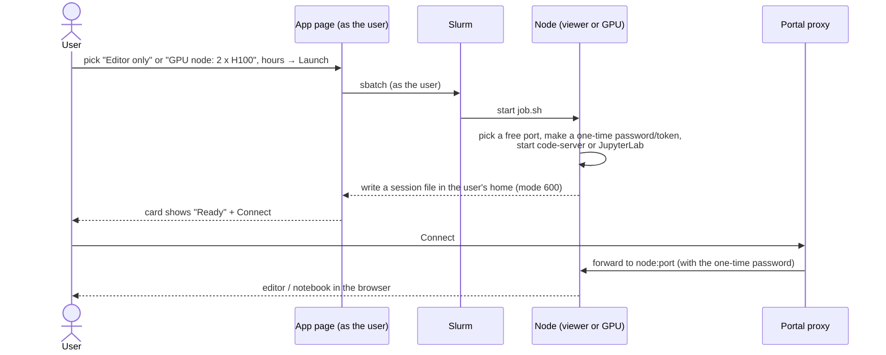

# VS Code and Jupyter in the browser

## What it is

Two coding tools that open in the browser, from the portal:
- **VS Code** (the open-source `code-server`): a full code editor with a terminal.
- **JupyterLab**: notebooks.

Each user gets **their own session, running as them**. They see exactly the files they could see over SSH, and nothing else.

## Why we need it

- Users can write and test code without installing anything on their laptop.
- The session runs **on the cluster**, next to the data and GPUs, so there is no copying back and forth.
- A "GPU node" session gives a notebook real GPUs for trying things out.

## How it works

**Two kinds of session**

| Choice | Runs on | Gets | For |
|---|---|---|---|
| **Editor only** / **Notebook only** | the `viewer` partition (login node) | 1 shared CPU, 2 GB (VS Code) or 4 GB (Jupyter) | writing code, small tests |
| **GPU node: n × &lt;GPU&gt;** | a GPU node | n GPUs + n shares of that node's CPUs and RAM | trying things on real GPUs |

- The GPU choices are read from Slurm at install time. A cluster with 8 × H100 per node offers 1 to 8 GPUs.
- One program install for everyone, on shared storage. Settings, extensions and own kernels stay in each user's home.

**Jupyter kernels**
- When a session starts, it looks in `/home/apps/containers/training/` and makes one kernel per image.
- New image copied in → it shows in the next session. Nothing to install.
- Users can add their own Python environment as a kernel too.

**Ending a session**
- When the chosen hours run out.
- Or after 1 hour with no browser attached (and, in Jupyter, no cell running). This frees the memory and GPUs.
- Or when the admin stops it from the Admin page. The user's page then shows a **"Stopped by the admin on &lt;time&gt;"**
  card. It stays until the user removes it with its bin button.
- A page with a running session reloads itself every 30 seconds, so a stop shows up without a manual reload.

## Design choices (and why)

- **A Slurm job per user, not one shared server.** These tools run the user's own code. A process can only run as
  one Linux user, so each person needs their own.
- **Not JupyterHub.** JupyterHub would also start one Jupyter per user on Slurm, but it adds a second login and
  a second server to run. The portal already does this job.
- **Our own launch page** (instead of OOD's standard form). It looks like Model Hub and MLflow, and launch,
  status, Connect and Stop are all on one page.
- **Jupyter has its own Python 3.12.** JupyterLab needs Python 3.10 or newer, and the nodes have 3.9. It runs from
  shared storage, so nothing is installed on the nodes.

## What the user sees

- **Interactive Apps → VS Code** or **Jupyter**: a choice, an hours box, **Launch**, then a card with **Connect** and **Stop**.

## What the admin does

- Install: `4-vscode/1..3-*.sh`, then `7-jupyter/1..2-*.sh`. After that, **Restart Web Server** in the portal.
- After GPU nodes change, rerun the app installers so the GPU choices match.

## Limits and known issues

- **Capacity of the login node** (test cluster: about 67 sessions at once). Memory is the limit, not CPU.
- A GPU session **holds its GPUs** until it ends, even when idle. Long training belongs in `sbatch`, which frees the GPUs when done.
- VS Code extensions come from Open VSX, not Microsoft's store. A few Microsoft-only ones (Pylance, Copilot,
  Remote-SSH) are not available. Python, Jupyter, GitLens and most others are.

Details: [OOD-Install/4-vscode/README.md](https://github.com/Ankush610/OOD-Install/blob/main/4-vscode/README.md), [OOD-Install/7-jupyter/README.md](https://github.com/Ankush610/OOD-Install/blob/main/7-jupyter/README.md).

Install and run it: [VS Code](../admin/install/vscode.md), [Jupyter](../admin/install/jupyter.md). Bugs and gaps: [Known issues → VS Code](../known-issues/vscode.md), [Jupyter](../known-issues/jupyter.md).
