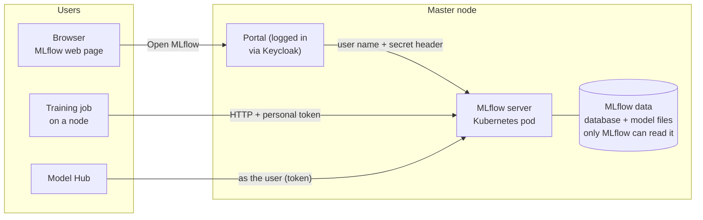

# MLflow (experiment tracking and model registry)

## What it is

**MLflow** is the platform's **lab notebook and model shelf**.
- **Tracking:** every training run records its settings, scores, charts and files.
- **Model registry:** the runs worth keeping are saved as named, numbered models (`churn` v1, v2…).

AI-Factory runs **one shared MLflow server** for everyone. Each user sees **only their own** experiments and models.

## Why we need it

- Users can compare runs and find the best model, without keeping notes by hand.
- It is the **one catalog of all models**: who made each one, from which run, with which scores. Model Hub reads
  its list of models from here. **Every model goes through MLflow first.**
- One server is easier to look after and back up than one per user.

## How it works



- **Where it runs:** one Kubernetes pod on master, always on. It is **not** a Slurm job, so it has no time limit.
- **Where data lives:** one folder on master's own disk: the database, the user list and all model files. Only the
  `mlflow` service account can read it. Users reach their files **only through MLflow**, which checks permissions.
- **Default permission = none.** A new experiment or model is visible only to its creator.

**Three ways in, one rule: always as yourself**

| Who | How they log in |
|---|---|
| Browser | through the portal, already logged in via Keycloak. The portal passes the user's name, plus a secret only it knows. MLflow trusts the name **only** with that secret. A fake name sent straight to MLflow gets refused |
| Training jobs | a random **token** in `~/.mlflow/credentials`, made for each user. MLflow's client reads it by itself. No password is ever in a script or file |
| Model Hub | runs as the user, with that same token |

**Experiment names**
- Experiment names are global. If two people choose `mnist`, the second one gets "permission denied" without
  knowing why.
- So the rule is: **`<user>/<name>`**, for example `alice/mnist`. Usernames are unique, so names never clash.

## What the user sees

- **Interactive Apps → MLflow (shared)**: a page with the tracking address (with a Copy button), the naming rule,
  short "if something goes wrong" help, and an **Open MLflow** button.
- In their script:
  ```python
  import mlflow
  mlflow.set_experiment("alice/my-experiment")
  with mlflow.start_run():
      mlflow.log_param("lr", 0.001)
      mlflow.log_metric("accuracy", 0.94)
      mlflow.sklearn.log_model(model, "model", registered_model_name="churn")
  ```
- The MLflow web page with only their own runs and models.

## What the admin does

- Install: `3-mlflow/1-build-image.sh`, `2-deploy.sh`, `3-sync-tokens.sh`, `4-install-ood-app.sh`.
- New users get their token automatically (`add-user.sh` runs `3-sync-tokens.sh`).
- **Backup:** the whole MLflow data folder as one piece. Losing the database loses every run and model version.
- **Upgrade:** change the version in `site.conf` and the image, rebuild, redeploy. The server must stay at the same
  or a newer version than the MLflow client inside the training images. The database upgrades itself, one way only.

## Limits and known issues

- **One server process** (more run out of memory at 2 GB). This is fine for ~100 users. Watch it if use grows.
- The database is SQLite on local disk. This is simple and fast enough, but it is tied to the master node.
- Training images carry a light MLflow client that can't open the database directly. Jobs must always use the
  HTTP tracking address.
- A "permission denied" error may also mean "this does not exist". MLflow answers the same way for both.

Details: [OOD-Install/3-mlflow/README.md](https://github.com/Ankush610/OOD-Install/blob/main/3-mlflow/README.md), [OOD-Install/3-mlflow/WORKFLOW.md](https://github.com/Ankush610/OOD-Install/blob/main/3-mlflow/WORKFLOW.md).
