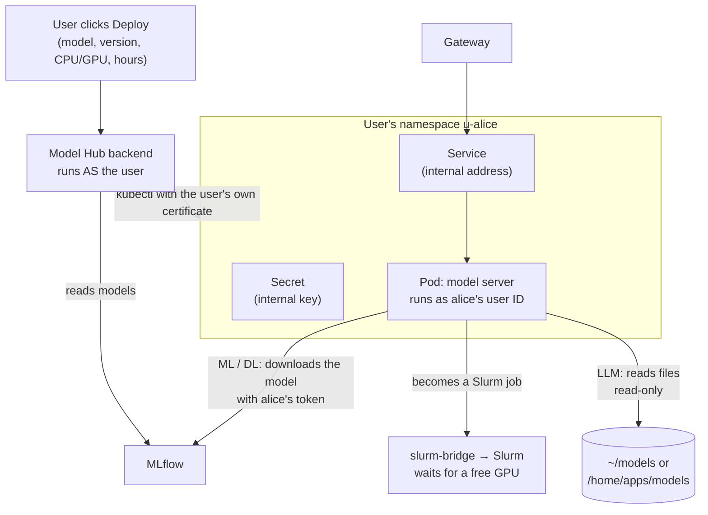
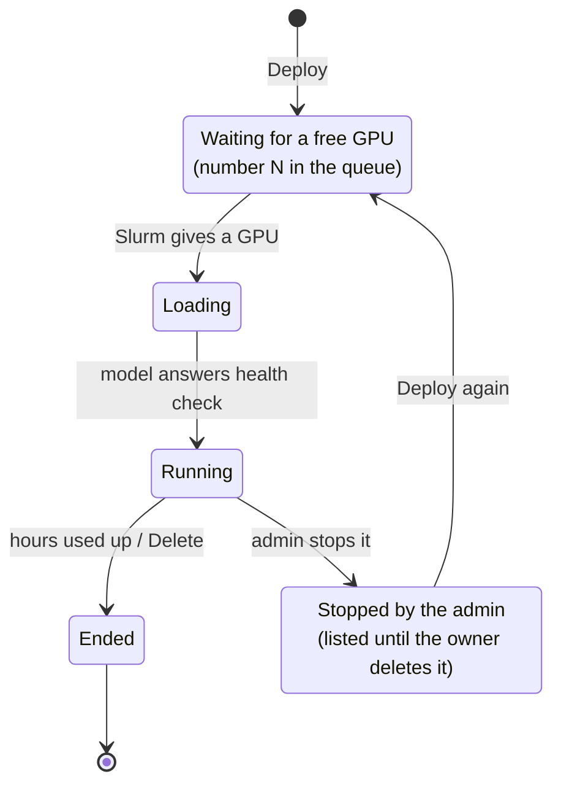

# Model Hub (putting models online)

## What it is

**Model Hub** is the portal app that turns a model registered in MLflow into a **running API** (an "endpoint"),
with a few clicks. It works for classic ML, deep learning and LLMs.

## Why we need it

- The main thing users ask for: **"I trained a model, now put it online."**
- Without it, a user would need Kubernetes, containers, GPUs, networking and keys. Model Hub does all of that for them.
- It keeps the cluster's rules: one GPU per person, time limits, training first.

## How it works

**What one "Deploy" creates** (in the user's own namespace, `u-<user>`)
- a **pod** that runs the model server, as the user's own ID, as a Slurm job with a time limit;
- a **Service**, an internal address that only the gateway uses;
- a **Secret** with an internal key (for LLMs; the caller never sees it).

**The right server for each model**

| Model type | Server | Where the model comes from |
|---|---|---|
| Classic ML | `mlflow-serve-ml` (CPU) | downloaded from MLflow when the pod starts |
| PyTorch | `mlflow-serve-torch` (GPU or CPU) | downloaded from MLflow when the pod starts |
| LLM (Hugging Face) | vLLM (1 or 2 GPUs) | read straight from `~/models` or `/home/apps/models`, read-only |

**Endpoint life**

**Per-user space and limits**

| Thing | What it does |
|---|---|
| Namespace `u-<user>` | the user's private Kubernetes space. They can deploy, see logs and delete there, and nowhere else |
| User-ID rule | every pod in it **must** run as that user's ID. So file permissions on shared storage still hold |
| "Restricted" pod rules | no root, no mounting host folders. Only two storage mounts: the user's `~/models` and the admin's models, both read-only |
| GPU limit | 1 GPU at a time by default. The admin can raise one person to 2. Enforced by Kubernetes, not only by the page |
| Time limit | 1 day by default, 4 days at most. Enforced by a cluster rule: a pod with no time limit, or a longer one, is refused |
| User certificate | each user gets a personal Kubernetes login (`~/.kube/aistack.config`, valid 1 year). Model Hub uses it to act as them |

**Public models**
- The owner of a model can click **Make public**. Every user can then see it, deploy their own copy, and download it.
- A background job (every minute, as root) copies the files to a place everyone can read, then gives everyone
  read access. **Make private** takes it back, and the copies are deleted.
- The owner's own files are never changed. Base models from the admin (Qwen and others) use the same button.
- Models are only **private** or **public**. To share files with a few people, users copy the files themselves.

**Downloads**
- **To my computer:** a `.zip` (ML and DL models; LLMs are too big for a browser).
- **To my cluster home:** a background copy into `~/model-downloads/`, with a progress bar.

## What the user sees

| Page | What is on it |
|---|---|
| **Models** | their models + public ones; search; All / Public / Private filter |
| **Model page** | a "model card": type, size, inputs, the run's scores, library versions; **Deploy**, **Download**, **Make public** |
| **My endpoints** | state, time left, the reason if it's waiting, "Stopped by the admin on &lt;time&gt;" if the admin stopped it; **Shared with me** below |
| **Playground** | try the model: a chat window for LLMs, a form for ML/DL |
| **API** | gateway address, the user's key, copy-ready `curl` and Python examples |
| **API key** | make a new personal key (shown once) |
| **Logs**, **Help** | the model server's log; plain-word help |

## What the admin does

- Install: `5-model-hub/1-setup.sh` → `2-sync-users.sh` → `4-images.sh` → `7-install-ood-app.sh` → `8-gateway.sh`.
  Test scripts (`3-`, `5-`, `6-`) prove each part works.
- Change one person's limits: `2-sync-users.sh bob --gpus 2` or `--max-hours 240`; `--reset` to undo; `--show` to list everyone.
- Change everyone's limits: edit `site.conf`, rerun `2-sync-users.sh`.
- **From the browser:** the Admin page lists every endpoint (owner, node, GPU, since when) and can stop one, and can
  change a person's limits. A stop deletes only the pod: the Slurm job ends, the GPU is free, and the owner sees it
  stopped and can deploy it again. See the [Admin guide](../admin/daily.md).
- **After any slurm-bridge upgrade:** rerun `1-setup.sh` (or GPUs stop working inside pods).

## Limits and known issues

- One model per endpoint, one or two GPUs on one node. Bigger models (across nodes) and auto-scaling are later.
- A public LLM in the admin's shared folder can be read on disk by everyone, even when "private". Really private
  LLMs belong in the owner's `~/models`.
- Making a model private stops new deploys and downloads. Copies others already downloaded, or endpoints already
  running, stay until they end.
- Not tested yet: a full LLM run through the browser, and a real 2-GPU model (needs H100 nodes).

Details: [OOD-Install/5-model-hub/README.md](https://github.com/Ankush610/OOD-Install/blob/main/5-model-hub/README.md), design: `OOD-Install/project/design/`.

Install and run it: [Model Hub](../admin/install/model-hub.md). Bugs and gaps: [Known issues → Model Hub](../known-issues/model-hub.md).
