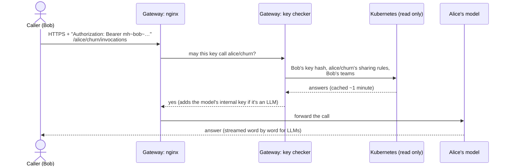

# Gateway and API keys (calling models safely)

## What it is

The **gateway** is the **one HTTPS address** for calling any deployed model, from inside the cluster or from a
laptop on the customer's network. Every call must carry the caller's **personal API key**.

```
https://<gateway>/<owner>/<endpoint>/<path>
e.g. https://models.example.org/alice/churn/invocations
     https://models.example.org/alice/qwen-legal/v1/chat/completions
```

## Why we need it

- Models run on internal addresses that change every time they restart. Users need one stable address.
- One place to check **who** is calling and **whether they may**, for every kind of model.
- One key per person is simple, like an OpenAI key. It can be replaced if it leaks.
- Later, one place to count usage ("who uses my GPUs?").

## How it works



**The pieces**

| Piece | What it is |
|---|---|
| nginx + a small key checker (`auth.py`) | one pod in its own namespace (`model-hub`), on master, as a non-root user with a read-only disk |
| Its address | a fixed IP on port 443, given by MetalLB (on a customer rack: an IP on their network, ideally with a DNS name) |
| Certificate | by default a self-signed "Rudra" certificate authority (made by cert-manager); users download `gateway-ca.crt` from Model Hub. Or the customer's own certificate |
| Read rights | it may read only Services and Secrets in **user** namespaces. It cannot read system namespaces |

**Personal API key**
- Made on Model Hub's **API key** page. It looks like `mh~alice~<48 random characters>`. It is **shown once**.
- Only a **hash** of it is stored (in the user's own namespace). Nobody can read the key back, not even the admin.
- Making a new key kills the old one within about a minute.
- One key works for every model the person may call: their own, and those shared with them.
- An LLM endpoint has its own internal key too. The gateway adds it, so users never see or handle it.

## Sharing

The owner picks, per endpoint, who may call it:

| Choice | Who may call |
|---|---|
| Only me | the owner (the default) |
| People | the owner + named users |
| Teams | the owner + members of LDAP teams (made by the admin) |
| Everyone | any user with a key |

- The rules are stored **on the endpoint itself**. Deleting the endpoint deletes them, and only the owner can change them.
- Each caller uses **their own** key, so the owner never has to give a key away.
- No admin approval is needed, even for "everyone".
- **Shared with me:** Model Hub lists the endpoints others shared with you. Users can't look into other users'
  namespaces, so the gateway answers this question on a separate port. It only answers a caller who proves who
  they are with their cluster certificate.

## What the user sees

The endpoint's **API** tab, ready to copy:

```bash
curl --cacert gateway-ca.crt \
  -H "Authorization: Bearer $MODEL_HUB_KEY" \
  -H "Content-Type: application/json" \
  -d '{"dataframe_records": [{"age": 42, "plan": "gold"}]}' \
  https://<gateway>/alice/churn/invocations
```

For LLMs, any OpenAI client works with `base_url = https://<gateway>/alice/qwen-legal/v1`.

**Common answers**

| Code | Means |
|---|---|
| 200 | OK |
| 401 | missing, wrong or old key (a new key needs up to a minute) |
| 403 | no such endpoint, **or** it is not shared with you (the same answer on purpose, so names can't be guessed) |
| 502 / 504 | the model is stopped, still loading, or waiting for a GPU |

## What the admin does

- Install: `5-model-hub/8-gateway.sh`, then rerun `2-sync-users.sh` (read rights) and `7-install-ood-app.sh`.
- Set the address in `site.conf`: `GATEWAY_IP`, and optionally `GATEWAY_HOST` (DNS name) and the customer's certificate.

## Security checks done

- **Path tricks:** a call like `/me/mine/../../bob/his` is checked as `bob/his`, the path nginx really routes to.
- **Fake Services:** users can create Services in their namespace. The gateway only follows Services shaped exactly
  like the ones Model Hub makes, so nobody can point it somewhere else.
- No key, a wrong key, someone else's key, or a model not shared with you is always refused (tested).

## Limits and known issues

- **Not the only way in yet.** Today, any pod inside the cluster can still reach a model's internal address
  directly. The **network lock** (replacing the network plugin, flannel, with Calico or Cilium) closes this.
  It is roadmap step 1 and needs senior approval.
- One gateway, no spare. If it stops, Kubernetes restarts it. Running models are not affected.
- Usage logging (who called what) is planned. Reports come later.

Details: [OOD-Install/5-model-hub/README.md](https://github.com/Ankush610/OOD-Install/blob/main/5-model-hub/README.md) (section "Gateway").
