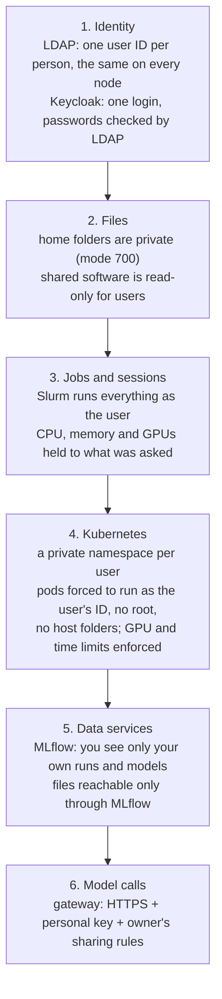

# Security and isolation (who can see and do what)

This page pulls together the security rules from every component in one place.

## The main idea

**Everything a user does runs as that user's own Linux ID.** Editors, notebooks, training jobs, and even
deployed models all run as that ID. File permissions on shared storage are the same on every node. So "can Alice
read this file?" has one answer everywhere. The other rules below are there to make sure nobody can step around this.

## Layers

## Who can see what

| Thing | Owner | Other users | Admin |
|---|---|---|---|
| Home folder (`/home/alice`) | read/write | ✗ cannot even list it | yes (root) |
| Shared software, images, base models | read | read | write |
| MLflow experiments and runs | yes | ✗ | yes |
| MLflow models | yes | ✗, unless **public** | yes |
| Model files (ML/DL) | through MLflow only | ✗, unless **public** (then a copy) | yes |
| Kubernetes namespace `u-alice` | deploy, logs, delete | ✗ | yes |
| A deployed endpoint | call it | only if **shared** with them | yes |
| API key | shown once, then only a hash is stored | ✗ | ✗ (only the hash) |
| Passwords | change own | ✗ | can reset (one-time), never read |
| Running jobs, sessions and endpoints | own | ✗ | see and stop all (Admin page) |

## Rules enforced by the cluster (not only by the web pages)

Users have a real Kubernetes login, so they could skip Model Hub and use `kubectl` directly. These rules hold even then:

| Rule | How |
|---|---|
| A pod must run as its namespace owner's user ID | admission policy: a pod with any other ID, or with root, is refused |
| No root, no host folders, no privileged containers | Kubernetes "restricted" pod security level on every user namespace |
| Max GPUs at once | ResourceQuota on the namespace; a direct GPU request can't get around it |
| Max run time | admission policy: no time limit, too long, or "whole node" → refused |
| Users can't change their own limits or teams | stored on the namespace, which users can't edit |
| Storage | only two read-only mounts: own `~/models` and the admin's models |

## Secrets and passwords

- Passwords are never written on a command line or into scripts. Scripts read them from files that only root can read.
- MLflow trusts the portal's "this is alice" header **only** with a secret that the portal alone adds. A request
  straight to MLflow with a fake name is refused.
- Keycloak's database listens only on master itself (127.0.0.1). Keycloak listens on master's address, but the
  firewall lets in only the login node, whose portal passes browsers on over HTTPS. Between the login node and master
  this hop is plain HTTP inside the rack (see Known gaps).
- The login node never gets root on master. Master copies the secrets the portal needs (its Keycloak client secret,
  MLflow's proxy secret) to root-only files on the login node.
- Keycloak's LDAP account may change passwords and **nothing else**. The install checks this: changing any other
  field as that account must fail, or the install stops.
- Service accounts (`mlflow`, `modelhub`, `keycloak`) have IDs below 1000 and are not in LDAP, so they can't clash with or pose as a person.

## The admin page

The Admin page can add and remove people, so it is locked down more than the other apps.

- The page runs as the **admin account** on the login node, not as root. Every read and change goes through one small
  root program on master (`aistack-admin`), over SSH with a key only the admin account can read. Master accepts that
  key only from the login node's address, and with it runs **only** that program: no shell, no other command. The
  page quotes each value it sends, and the program splits them again without a shell. On master's terminal the admin
  uses `sudo` instead.
- That program accepts **only** the admin account (the key, or `sudo` as admin), a **fixed list** of actions, and names that pass the same checks
  as the scripts. It uses no shell, so nothing a browser sends becomes a command.
- Passwords go in only through standard input. They are never on a command line, in the log, or in an answer.
- One change at a time. Every change **and every refused attempt** goes to a root-only log (who, what, when, result).
- The `admin` account itself can't be removed from the page.
- The page has three locks: other users can't read its folder (it isn't in their menu); its backend answers 403 to
  anyone else; changes need a header that a form on another website can't send.

## Tested

- Another user can't download a private model's files from MLflow, even with the exact file path (403).
- The gateway refuses no key, wrong key, someone else's key, and not-shared models. It also blocks path tricks and fake Services.
- A pod with another user's ID, root, no time limit, too long a time, or a second GPU is refused.
- Removing a person: every job, process, portal session, endpoint, key, namespace, MLflow entry, Keycloak and LDAP
  entry was gone within a minute, and their open portal tabs went to the login page.
- The admin program refuses bad names, command tricks (`bob;rm -rf /`), path tricks, out-of-range limits, and anyone
  but the admin account.

## Known gaps (open)

| Gap | Risk | Plan |
|---|---|---|
| **No network lock yet** | any pod in the cluster can reach a model's internal address and skip the gateway | replace flannel with Calico/Cilium; allow only the gateway to reach models (roadmap step 1, needs senior approval) |
| Self-signed certificates | browsers show a warning until users trust the CA | the customer gives a real certificate |
| Public ML/DL models run their owner's code | a public model could contain harmful code | the model page warns users; the network lock limits what it can reach |
| The admin program runs the install scripts, which the scripts' owner can edit | only matters once more people get admin rights | make `OOD-Install` root-owned before adding an admin team (roadmap step 9) |
| Registry over plain HTTP | only inside the cluster network | acceptable for an internal LAN |
| Login node → Keycloak over plain HTTP | with separate login and master machines, the login form (passwords) and tokens cross the rack network unencrypted | acceptable on a private rack; else give Keycloak its own certificate |

See also: [03 Users and login](03-users-and-login.md), [09 Model Hub](09-model-hub.md), [10 Gateway](10-gateway-and-api-keys.md).

Every security finding from the code review, in one list: [Known issues → Security](../known-issues/security.md).
