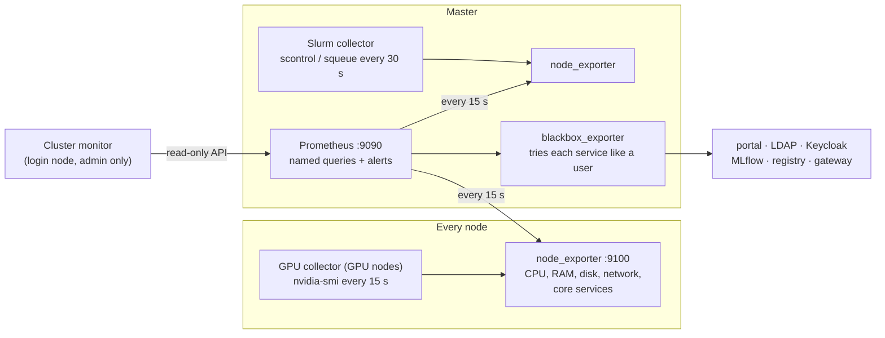

# Monitoring

## What it is

One **Prometheus** on master is the platform's single source of metrics. It collects every node's hardware, GPU,
Slurm and service state, checks alert rules, and feeds the admin's [Cluster monitor](../admin/cluster-monitor.md).

## Why we need it

- The admin needs one page that answers "is everything up, who is using which GPU, and what needs fixing?"
- Apps (the Cluster monitor today, Model Hub later) should read one set of named numbers, not each invent their own
  queries.
- Problems such as a missing GPU, memory errors, a stopped login service or an expiring certificate should be found
  before users notice.

## How it works

- **Plain programs under systemd, not Kubernetes.** Monitoring must keep working when Kubernetes has a problem. Every
  download is checked against a pinned sha256.
- **Nothing borrowed.** GPU data comes from `nvidia-smi` (not the GPU operator), Slurm data from `scontrol` and
  `squeue` (no `slurm.conf` change). Both are written to node_exporter's "textfile" folder.
- **No stale numbers.** Collectors write their file in one step. If the source fails, the file says
  `collector_ok 0` and has no numbers, rather than old ones. A collector that stops entirely trips `CollectorStale`.
- **Only real GPUs count.** GPU types Slurm doesn't schedule (for example a small display card) are ignored.
- **Named queries.** `rules.yml` defines names such as `slurm:node_gpus_free` and `node:cpu_used:ratio`. Apps use the
  names; if the way something is measured changes, it changes there once.
- **Reserved vs used.** Slurm *reserves* CPUs, memory and GPUs for jobs; the hardware *uses* some of that. The page
  shows both, so "GPUs reserved but idle" is visible.
- **Core services watched where they are enabled.** Each node watches only the services from `MONITOR_UNITS` it has
  enabled, so a service that is installed but off on purpose (like `nfs-server` on compute nodes) never looks "down".
- **Alerts.** 16 platform alerts (`rules.yml`) and 18 standard node alerts (node-mixin). Rules are tested with
  `promtool` before they replace the running ones. See the [Monitoring reference](../reference/monitoring.md).

## Security

- **Prometheus has no password, on purpose.** Portal apps run as the logged-in user, so any secret they read, every
  user could read. The data is usage and job counts users can already see with `squeue`.
- **The firewall protects it instead:** port 9090 only from the login node, node_exporter only from master,
  blackbox only on 127.0.0.1. The API is read-only (no admin or shutdown endpoints).
- **The page is admin-only:** its folder is readable only by `OOD_ADMIN`'s group. It runs fixed queries; the only
  value from the browser, a node name, is checked first.

## What the user sees

Nothing. Normal users can't see or open the Cluster monitor.

## What the admin does

- Install: `9-monitoring/1-install.sh` (master), `2-install-ood-app.sh` (login node). See
  [Install → Monitoring](../admin/install/monitoring.md).
- Daily: the [Cluster monitor](../admin/cluster-monitor.md). When an alert fires, follow its **How to fix** link.

## Limits and known issues

- **No email or paging yet**, and nothing watches the watcher: if master stops, monitoring stops silently.
- **One Prometheus, 30 days of history**, no long-term storage.
- **No per-job GPU use.** Only per-GPU numbers from `nvidia-smi`.
- The Prometheus in Kubernetes' `monitoring` namespace belongs to KEDA, not to this.

More: [Known issues → Monitoring](../known-issues/monitoring.md).
