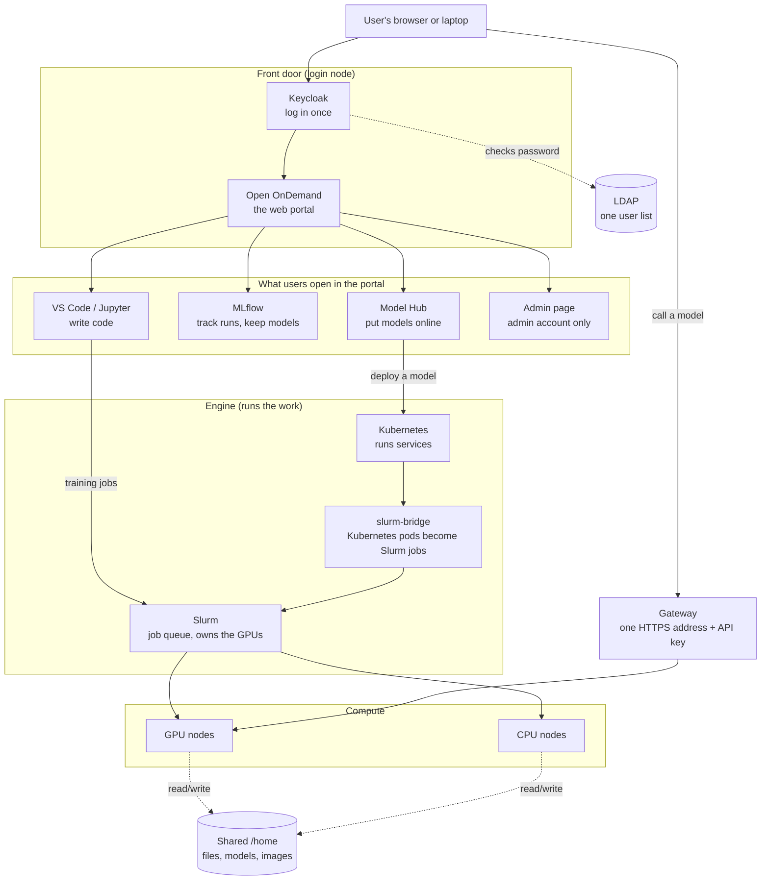

# How it works

These pages explain how each part of AI-Factory works and why it is built that way. For step-by-step
help, see the [User guide](../user/index.md) or the [Admin guide](../admin/index.md).

## The big picture

**In one line each:**

| Component | Its job | Page |
|---|---|---|
| Cluster hardware | 1 master, 1 login, 2 GPU nodes, 3 CPU nodes, shared storage | [01](01-cluster-architecture.md) |
| LDAP + Keycloak | one list of users, one login for every web tool | [03](03-users-and-login.md) |
| Open OnDemand (OOD) | the web portal, the front door | [04](04-web-portal-ood.md) |
| Slurm + Kubernetes + slurm-bridge | run jobs and services, share the GPUs fairly | [05](05-slurm-and-kubernetes.md) |
| Containers + registry | ready-made software images for training and serving | [06](06-containers-and-registry.md) |
| VS Code + Jupyter | write code and notebooks in the browser | [07](07-vscode-and-jupyter.md) |
| MLflow | record every training run, keep the trained models | [08](08-mlflow.md) |
| Model Hub | turn a trained model into a running API | [09](09-model-hub.md) |
| Gateway | the one secure address to call models, with a personal key | [10](10-gateway-and-api-keys.md) |
| Monitoring | one Prometheus: nodes, GPUs, services, alerts; the admin's Cluster monitor | [12](12-monitoring.md) |
| Admin page | for the customer's admin: see and stop what runs, add and remove people, teams, limits | [11](11-security-and-isolation.md#the-admin-page), [Admin guide](../admin/index.md) |

---

## How to read these pages

- They describe the **production design**, which is the Rudra rack. Where our test cluster is different, a short
  note says **(test cluster: …)**.
- Every component page has the same parts: what it is, why we need it, a diagram, how it works, what the user
  sees, what the admin does, and limits.
- These pages explain *how it works*. The exact steps are in the [Admin guide](../admin/index.md) (one install page
  per component), the settings and ports in the [Reference](../reference/index.md), and the bugs and gaps found in
  the code in [Known issues](../known-issues/index.md). The design decisions are in `AI-Stack/docs/`.

## Where the code lives

| Folder | What is in it |
|---|---|
| `OOD-Install/` | the install scripts, one numbered folder per component. One settings file, `site.conf`, holds every site value |
| `AI-Stack/docs/` | the design documents: architecture, Model Hub design, build plans, and logs of problems and fixes |
| `/home/apps/containers/` (on the cluster) | the training and serving container images |
