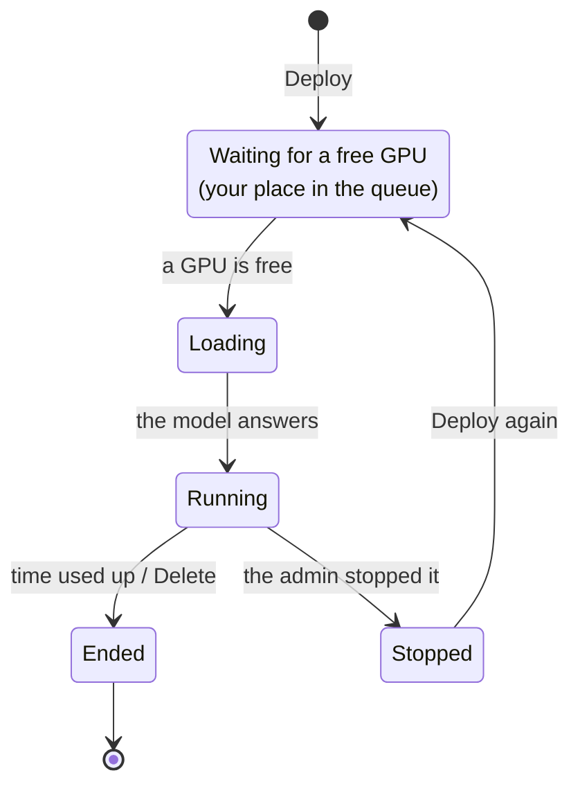

# Deploy a model (Model Hub)

**Model Hub** turns a model you registered in MLflow into a **running API**, called an **endpoint**. It works for
classic ML, deep learning and large language models (LLMs). You don't need Kubernetes, containers or networking:
Model Hub does that part.

Open it from **Interactive Apps → Model Hub**.

## The pages

| Page | What is on it |
|---|---|
| **Models** | your models and the public ones; search; All / Public / Private filter |
| **Model page** | the model card: type, size, inputs, the run's scores, library versions; **Deploy**, **Download**, **Make public** |
| **My endpoints** | your running models: state, time left, why one is waiting. **Shared with me** lists other people's endpoints you may call |
| **Playground** | try an endpoint: a chat window for LLMs, a form for ML and DL models |
| **API** | the endpoint's address and copy-ready `curl` and Python examples |
| **API key** | make your personal key for calling models |
| **Logs**, **Help** | the model server's log; plain-word help |

## Deploy

1. **Models** → open your model.
2. Click **Deploy**.
3. Give the endpoint a **name** (lowercase letters, numbers and dashes).
4. Pick the **hardware**: CPU or a GPU.
5. Pick how long to **keep it running** (1 day by default, 4 days at most). It stops on its own after this.
6. Click **Deploy**.

The endpoint then goes through these states:

- **Waiting** means all GPUs are busy. Training always comes first, so your model waits its turn. The page shows
  your place in the queue.
- **Loading** can take a few minutes for a big LLM.
- **Stopped by the admin**: the endpoint stays in the list until you delete it. Deploy it again when you need it.

## Which server runs your model

You don't choose this. Model Hub picks it from the model type.

| Model | Served by | Called with |
|---|---|---|
| classic ML (scikit-learn, XGBoost…) | MLflow model server, CPU | `/invocations` |
| PyTorch | MLflow model server, GPU or CPU | `/invocations` |
| LLM (Hugging Face) | vLLM, 1 or 2 GPUs | OpenAI-style `/v1/chat/completions` |

## Try it

Open the endpoint's **Playground**: chat with an LLM, or fill in the inputs of an ML model and see its answer.
When it works, go to the **API** tab to call it from your own code: [Call and share a model](call-api.md).

## Public models

- **Make public** on a model page: every user can then see it, deploy their own copy and download it.
- **Make private** takes it back. Copies others already downloaded, and endpoints already running, stay until they end.
- Models are either private or public. To give files to a few people only, copy the files to them yourself.
- The admin's base models (for example Qwen) are public models too: deploy your own copy of one.

## Download a model

- **To my computer:** a `.zip` (ML and DL models; LLMs are too big for a browser).
- **To my cluster home:** a copy into `~/model-downloads/`, with a progress bar.

## Limits

- **1 GPU** at a time for your endpoints (the admin can raise this to 2).
- **4 days** at most per endpoint. Deploy again to keep going.
- One model per endpoint, on one node.
